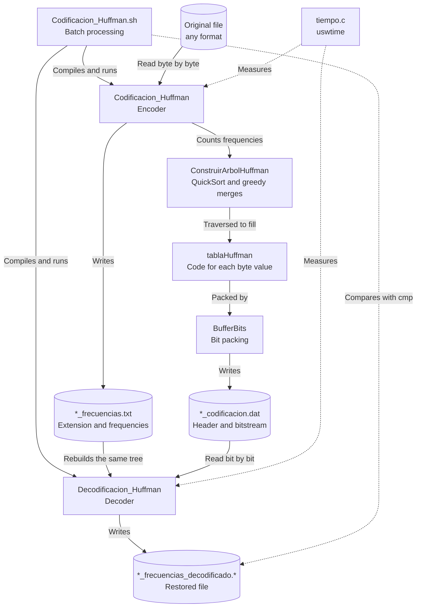

<h1 align="center">Huffman Compressor</h1>

<p align="center">
  <i>Lossless file compressor based on greedy Huffman coding, with bit-level packing and execution time measurement.</i>
</p>

<p align="center">
  
  
  
  
  
  
</p>

---

## Introduction

File compressor implemented in C that applies **greedy Huffman coding** to any type of file. The encoder counts how often each byte value appears, builds the Huffman tree by repeatedly merging the two lowest-frequency trees, and packs the resulting variable-length codes into bits. The decoder rebuilds the same tree from a separate frequency table and restores the original file byte by byte. Both programs measure their execution time, and a Bash script automates batch encoding, decoding and verification.

The formal foundations and analysis of the project are documented in the [PDF report (Reporte-Huffman.pdf)](Reporte/Reporte-Huffman.pdf), written in Spanish, including the theoretical background (entropy, prefix codes and the optimality of the greedy choice), a step-by-step construction of the tree for `ABRACADABRA`, the implementation and storage format, the complexity analysis, and the experimental results for 21 files from 28 bytes to 2.2 GB.

---

## Table of Contents

- [Introduction](#introduction)
- [Table of Contents](#table-of-contents)
- [Description](#description)
- [System Architecture](#system-architecture)
  - [Core Components](#core-components)
- [Project Structure](#project-structure)
- [Technology Stack](#technology-stack)
  - [Backend \& Core](#backend--core)
  - [Data Structures](#data-structures)
- [Prerequisites](#prerequisites)
  - [Installation Verification](#installation-verification)
- [Installation and Execution](#installation-and-execution)
  - [Step 1: Clone or Download Files](#step-1-clone-or-download-files)
  - [Step 2: Compile the Project](#step-2-compile-the-project)
  - [Step 3: Encode a File](#step-3-encode-a-file)
  - [Step 4: Decode and Verify](#step-4-decode-and-verify)
- [Algorithm Characteristics](#algorithm-characteristics)
  - [Greedy Strategy](#greedy-strategy)
  - [Tree Construction](#tree-construction)
  - [Code Assignment](#code-assignment)
  - [Decoding](#decoding)
  - [Compression Behavior](#compression-behavior)
- [File Formats](#file-formats)
  - [Encoded File (.dat)](#encoded-file-dat)
  - [Frequency Table (.txt)](#frequency-table-txt)
  - [Output File Names](#output-file-names)
- [Measurements and Complexity](#measurements-and-complexity)
  - [Compression Percentage](#compression-percentage)
  - [Execution Time](#execution-time)
  - [Complexity Analysis](#complexity-analysis)
- [Data Model](#data-model)
  - [Struct: Nodo](#struct-nodo)
  - [Struct: Arbol](#struct-arbol)
  - [Struct: CodigoHuffman](#struct-codigohuffman)
  - [Struct: BufferBits](#struct-bufferbits)
  - [Macros: Bit Handling](#macros-bit-handling)
  - [Library: tiempo](#library-tiempo)
- [Useful Commands](#useful-commands)
  - [Compilation](#compilation)
  - [Execution](#execution)
  - [Verification](#verification)
- [System Features](#system-features)
  - [Functionalities](#functionalities)
  - [Execution Modes](#execution-modes)
- [Usage Examples](#usage-examples)
  - [Example 1: Small Text File](#example-1-small-text-file)
  - [Example 2: Large Random Text](#example-2-large-random-text)
  - [Example 3: Batch Processing](#example-3-batch-processing)
  - [Generated Output Files](#generated-output-files)
- [Troubleshooting](#troubleshooting)
  - [Error: "multiple definition of main"](#error-multiple-definition-of-main)
  - [Error: "undefined reference to uswtime"](#error-undefined-reference-to-uswtime)
  - [Error: "tiempo.h: No such file or directory"](#error-tiempoh-no-such-file-or-directory)
  - [Error: "Error al abrir archivo"](#error-error-al-abrir-archivo)
  - [Batch list not found](#batch-list-not-found)
  - [Negative compression percentage](#negative-compression-percentage)
  - [Decoded file does not match the original](#decoded-file-does-not-match-the-original)
  - [Zero times or CPU/Wall above 100%](#zero-times-or-cpuwall-above-100)
  - [Compilation fails on Windows](#compilation-fails-on-windows)
- [Author](#author)
- [License](#license)

---

## Description

Console implementation in C of Huffman's greedy algorithm over the 256 possible byte values. Files are read in binary mode, so the input can be text, an image, a video or any other format. The savings depend on how the bytes are distributed, not on the file extension.

| Component | Description |
|----------|-------------|
| Algorithm | Greedy Huffman coding |
| Alphabet | 256 byte values (0–255) |
| Programs | Encoder and decoder |
| Outputs | Encoded file (`.dat`) and frequency table (`.txt`) |
| Measurements | Sizes, compression percentage and execution times |
| Automation | Bash script for batch processing |

---

## System Architecture



### Core Components

**Encoder (Codificacion_Huffman.c):**
- **LeerArchivo_Frecuencia** - Counts each byte value of the input
- **EscribirTablaFrecuencias** - Saves the original extension and the frequencies
- **ConstruirArbolHuffman** - Sorts the trees with QuickSort and merges the two lowest-frequency ones
- **GenerarCodigosHuffman** - Assigns `0` to left branches and `1` to right branches
- **CodificarArchivo** - Writes the header and the packed codes
- **BufferBits** - Groups bits into bytes before writing them

**Decoder (Decodificacion_Huffman.c):**
- **LeerArchivo** - Reads the extension and the frequencies from the table
- **ConstruirArbolHuffman** - Rebuilds the encoder's tree with the same procedure
- **DecodificarArchivo** - Walks the tree bit by bit until the original size is restored

**Utilities:**
- **tiempo.c / tiempo.h** - `uswtime` timing function
- **NombreBase** - Splits a path into base name and extension (both programs)
- **Codificacion_Huffman.sh** - Batch compilation, encoding, decoding and verification

---

## Project Structure

```
Huffman/
├── Codificacion_Huffman.c      # Encoder: frequencies, tree, codes and bit packing
├── Decodificacion_Huffman.c    # Decoder: tree reconstruction and file recovery
├── tiempo.c                    # Timing library (uswtime)
├── tiempo.h                    # Timing library header
├── Codificacion_Huffman.sh     # Batch encoding, decoding and verification script
├── .gitignore                  # Git ignored files
├── Reporte/                    # Formal report directory
│   └── Reporte-Huffman.pdf     # Formal report (PDF)
└── README.md                   # This file
```

---

## Technology Stack

### Backend & Core

| Technology | Version | Usage |
|-----------|---------|------|
| C | GNU11 | Main language |
| GCC | 4.7+ | Compiler |
| Bash | 3.2+ | Batch processing script |
| stdio.h | Built-in | Binary file I/O |
| sys/stat.h | POSIX | File sizes |
| sys/resource.h, sys/time.h | POSIX | Time measurement |

### Data Structures

| Structure | Usage |
|-----------|------|
| Array of 256 `Nodo` | Frequency count indexed by byte value |
| Array of `Arbol *` | Trees sorted with QuickSort before each merge |
| Binary tree (`Arbol`) | Huffman tree; each leaf is a byte |
| Array of 256 `CodigoHuffman` | Code table (`tablaHuffman`) |
| Bit buffer (`BufferBits`) | Packs codes into bytes |

---

## Prerequisites

- GCC 4.7 or higher (GNU C11 support)
- Bash 3.2 or higher and `cmp` for the batch script
- Operating system: Linux or macOS (on Windows, use WSL)

### Installation Verification

```bash
gcc --version
bash --version
```

Expected output:
```
gcc (GCC) 4.7.x or higher
GNU bash, version 3.2.x or higher
```

On macOS, `gcc --version` reports Apple clang, which also compiles the project.

---

## Installation and Execution

### Step 1: Clone or Download Files

```bash
# If in a repository
git clone <repository-url>
cd ESCOM/Huffman

# Or manually download the .c, .h and .sh files
```

### Step 2: Compile the Project

```bash
gcc -std=gnu11 -Wall -Wextra Codificacion_Huffman.c tiempo.c -o Codificacion_Huffman
gcc -std=gnu11 -Wall -Wextra Decodificacion_Huffman.c tiempo.c -o Decodificacion_Huffman
```

Each program has its own `main`, so they are compiled separately. `tiempo.c` emits a warning about the unused variable `mega`; the build still succeeds.

### Step 3: Encode a File

```bash
./Codificacion_Huffman <original_file>
```

The encoder writes `<base>_codificacion.dat` and `<base>_frecuencias.txt` next to the input, where `<base>` is the path without its extension.

### Step 4: Decode and Verify

```bash
./Decodificacion_Huffman <base>_codificacion.dat <base>_frecuencias.txt
cmp <original_file> <base>_frecuencias_decodificado.<ext>
```

The decoder writes `<base>_frecuencias_decodificado.<ext>`. `cmp` prints nothing and returns 0 when both files are identical.

---

## Algorithm Characteristics

### Greedy Strategy

Huffman coding assigns **variable-length prefix codes**: frequent bytes get short codes and rare bytes get long ones. No code is a prefix of another, so the bitstream needs no separators. The greedy choice, always merging the two trees with the lowest frequency, produces an optimal prefix code for the measured frequencies.

### Tree Construction

1. Count each byte value in an array of 256 positions
2. Create one leaf per byte value present, in increasing byte order
3. Sort the trees by frequency with QuickSort (Lomuto partition, last element as pivot)
4. Merge the first two: the first becomes the left child, the second the right child
5. Repeat steps 3 and 4 until one tree remains

The procedure is deterministic and the table keeps the order of the leaves, so the decoder builds exactly the same tree, even when frequencies tie.

### Code Assignment

| Rule | Detail |
|------|--------|
| Left branch | Bit `0` |
| Right branch | Bit `1` |
| Storage | 32-byte array per byte value (up to 256 bits), first bit in the most significant position |
| Single-symbol file | 1-bit code `0` |
| Empty file | No tree; the `.dat` only holds the header |

### Decoding

- Reads the original size from the header
- Starts at the root: bit `0` moves left, bit `1` moves right
- On a leaf, writes its byte and returns to the root
- Stops after writing the original number of bytes, so the padding bits are never decoded
- If the tree is a single leaf, writes that byte as many times as the header indicates

### Compression Behavior

| Input | Size | Compression | Reason |
|-------|------|-------------|--------|
| `AAAAABBC` | 8 B | -537.50% | Header and table outweigh the savings |
| 4096 × `A` | 4,096 B | 86.67% | Single symbol: 1 bit per byte |
| English text (GPL-3 license) | 35,149 B | 40.00% | Uneven letter frequencies |
| Random letters and digits | 10 MiB | 25.40% | 62 equiprobable symbols: about 5.97 bits per byte |
| Linux executable (`ls`) | 142,312 B | 23.39% | About a quarter of its bytes are `0x00` |
| PDF document | 234,113 B | -1.33% | Compressed streams, close to 8 bits per byte |
| PNG image | 17,430 B | -16.53% | Already compressed; the table adds overhead |
| gzip file | 3,737 B | -76.29% | Already compressed and small |
| Empty file | 0 B | — | No percentage; only header and table are written |

---

## File Formats

### Encoded File (.dat)

| Offset | Size | Content |
|--------|------|---------|
| 0 | `sizeof(long long)` (8 bytes) | Original file size, in the machine's native byte order |
| 8 | ⌈B/8⌉ bytes | Codes packed from the most to the least significant bit; the last byte is padded with zeros |

The tree is not stored: the decoder rebuilds it from the frequency table.

### Frequency Table (.txt)

```
C F ASCCI
txt
'A' 5 65
'B' 2 66
'C' 1 67
```

| Line | Content |
|------|---------|
| 1 | Literal header `C F ASCCI` (character, frequency, byte value) |
| 2 | Original extension without the dot (empty if there is none) |
| 3+ | One row per byte present, in increasing order: `'c' frequency value` for printable bytes (32–126), `0xHH frequency value` for the rest |

Despite the `ASCCI` label, the table covers all 256 byte values, not only ASCII.

### Output File Names

| Input | Encoder output | Decoder output |
|-------|----------------|----------------|
| `ejemplo.txt` | `ejemplo_codificacion.dat`, `ejemplo_frecuencias.txt` | `ejemplo_frecuencias_decodificado.txt` |
| `fotos/mapa.bmp` | `fotos/mapa_codificacion.dat`, `fotos/mapa_frecuencias.txt` | `fotos/mapa_frecuencias_decodificado.bmp` |
| `datos` (no extension) | `datos_codificacion.dat`, `datos_frecuencias.txt` | `datos_frecuencias_decodificado` |
| `.bashrc` (hidden file) | `.bashrc_codificacion.dat`, `.bashrc_frecuencias.txt` | `.bashrc_frecuencias_decodificado` |

- The decoder names its output after the frequency table and restores the extension stored in it
- Outputs are written next to the input and overwritten if they already exist

---

## Measurements and Complexity

### Compression Percentage

```
compression (%) = 100 × (1 − (dat_size + table_size) / original_size)
```

Both files needed to restore the input are counted. A negative value means the output is larger than the input. For an empty input no percentage is printed.

### Execution Time

| Measure | Meaning |
|---------|---------|
| real | Elapsed time of the measured region, including its I/O |
| user | CPU time in user mode |
| sys | CPU time in kernel mode (system calls such as I/O) |
| CPU/Wall | `100 × (user + sys) / real` |

Only `CodificarArchivo` and `DecodificarArchivo` are timed; frequency counting, tree construction and code generation fall outside the interval. Each measurement is printed twice, in decimal and scientific notation.

### Complexity Analysis

For `n` input bytes, `k ≤ 256` distinct byte values and `B` encoded bits:

| Stage | Complexity |
|-------|------------|
| Frequency count | O(n) |
| Tree construction | O(k³) worst case; O(k² log k) with balanced partitions |
| Code generation | O(k) |
| Encoding / decoding the data | O(n + B) |
| Total, with the fixed byte alphabet | O(n) |

The file is processed as a stream and never loaded entirely into memory, so auxiliary memory does not grow with `n`. The [formal report](Reporte/Reporte-Huffman.pdf) derives these bounds and fits the measured times against file size.

---

## Data Model

### Struct: Nodo

Associates a byte with its number of occurrences. Both programs define it.

| Field | Type | Description |
|-------|------|-------------|
| caracter | char | Byte value |
| frecuencia | long long | Number of occurrences |

**Main functions:**
- `InicializarFrecuencias(Nodo *)` - Places byte i at position i with frequency 0
- `LeerArchivo_Frecuencia(char *, Nodo *)` - Counts the bytes of the input (encoder)
- `LeerArchivo(char *, Nodo *, char *, size_t)` - Loads the frequencies from the table (decoder)

### Struct: Arbol

Huffman tree node. Leaves are recognized by having no children, not by their byte, because byte 0 is a valid symbol.

| Field | Type | Description |
|-------|------|-------------|
| frecuencia | long long | Leaf frequency or sum of the subtree |
| caracter | char | Leaf byte; `'\0'` in internal nodes |
| izq | struct Arbol * | Left child (bit 0); NULL in a leaf |
| der | struct Arbol * | Right child (bit 1); NULL in a leaf |

**Main functions:**
- `CrearNodoArbol(char, long long)` - Creates a leaf
- `FusionarArboles(Arbol *, Arbol *)` - Creates an internal node with the sum of both frequencies
- `QuickSortArboles(Arbol **, int, int)` - Sorts the trees by frequency
- `ConstruirArbolHuffman(Nodo *, int)` - Builds the tree; returns NULL for an empty file
- `LiberarArbol(Arbol *)` - Frees the tree in postorder

### Struct: CodigoHuffman

Code of one byte value. The global table `tablaHuffman[256]` holds one entry per byte value.

| Field | Type | Description |
|-------|------|-------------|
| codigo | unsigned char * | 32-byte array (256 bits); the first bit is the most significant of `codigo[0]` |
| longitud | long long | Code length in bits; 0 if the byte does not appear |

**Main functions:**
- `InicializarTablaHuffman()` - Allocates the 256 code arrays
- `GenerarCodigosHuffman(Arbol *, unsigned char *, int)` - Fills the table with a depth-first traversal
- `LiberarTablaHuffman()` - Frees the table

### Struct: BufferBits

Accumulates bits until a full byte can be written.

| Field | Type | Description |
|-------|------|-------------|
| buffer | unsigned char | Byte under construction, filled from the most significant bit |
| contador | int | Bits already placed (0 to 7) |
| archivo | FILE * | Output file |

**Main functions:**
- `InicializarBufferBits(BufferBits *, FILE *)` - Empties the buffer and links it to the file
- `EscribirBit(BufferBits *, int)` - Adds one bit and writes the byte when it is complete
- `EscribirBits(BufferBits *, unsigned char *, int)` - Writes a complete code
- `ManejarUltimoByte(BufferBits *)` - Pads the last byte with zeros and writes it

### Macros: Bit Handling

Bit 0 is the least significant and bit 7 the most significant.

| Macro | Description |
|-------|-------------|
| PESOBIT(bpos) | Mask with a 1 only at position `bpos` |
| CONSULTARBIT(var, bpos) | Value (0 or 1) of bit `bpos` |
| PONE_1(var, bpos) | Sets bit `bpos` to 1 |
| PONE_0(var, bpos) | Sets bit `bpos` to 0 |

### Library: tiempo

Timing library provided in the course by M. en C. Edgardo Adrián Franco Martínez.

**Functions:**
- `uswtime(double *usertime, double *systime, double *walltime)` - Stores the current user, system and wall-clock time of the process, using `getrusage` and `gettimeofday`

---

## Useful Commands

### Compilation

```bash
# Compile the encoder
gcc -std=gnu11 -Wall -Wextra Codificacion_Huffman.c tiempo.c -o Codificacion_Huffman

# Compile the decoder
gcc -std=gnu11 -Wall -Wextra Decodificacion_Huffman.c tiempo.c -o Decodificacion_Huffman

# Compile only the timing library (object file)
gcc -c tiempo.c

# Clean compiled files
rm -f Codificacion_Huffman Decodificacion_Huffman *.o
```

### Execution

```bash
# Encode a file
./Codificacion_Huffman ejemplo.txt

# Decode it with its frequency table
./Decodificacion_Huffman ejemplo_codificacion.dat ejemplo_frecuencias.txt

# Quote paths that contain spaces
./Codificacion_Huffman "mis archivos/imagen.bmp"

# Process every file listed in archivos_a_codificar.txt
bash Codificacion_Huffman.sh

# macOS: keep the computer awake during long batches
caffeinate bash Codificacion_Huffman.sh
```

### Verification

```bash
# Compare the restored file with the original (silent if identical)
cmp ejemplo.txt ejemplo_frecuencias_decodificado.txt
echo $?

# View the frequency table
cat ejemplo_frecuencias.txt

# Inspect the encoded file in hexadecimal
xxd ejemplo_codificacion.dat

# Compare file sizes
ls -l ejemplo*

# View the batch logs
cat codificacion.txt
tail -n 20 decodificacion.txt

# Remove generated files
rm -f *_codificacion.dat *_frecuencias.txt *_frecuencias_decodificado*
```

---

## System Features

### Functionalities

- Lossless compression of any file type
- Frequency count over the 256 byte values
- Greedy Huffman tree construction with QuickSort
- Variable-length prefix codes packed into bits
- Frequency table that keeps the original extension
- Identical tree reconstruction in the decoder, even with tied frequencies
- Exact recovery that ignores the padding bits
- Support for empty and single-symbol files
- Printable and non-printable bytes in the table
- Compression percentage that includes the frequency table
- Time measurement: real, user, sys and CPU/Wall
- Output in decimal and scientific notation
- Batch processing with automatic verification
- Paths with spaces, hidden files and files without extension

### Execution Modes

**Individual Mode:**
- One file per execution
- Encoder and decoder run separately
- Sizes, percentage and times printed to the console
- Manual verification with `cmp`

**Batch Mode:**
- Reads `archivos_a_codificar.txt`, one path per line
- Compiles both programs before processing
- Encodes, decodes and compares every file with `cmp -s`
- Stops at the first compilation, execution or comparison error
- Accepts empty lines, CRLF line endings and a last line without a newline
- Saves the program output in `codificacion.txt` and `decodificacion.txt`, cleared on each run

---

## Usage Examples

### Example 1: Small Text File

**Input:** `ejemplo.txt` containing `AAAAABBC` (8 bytes, no newline)

```bash
printf 'AAAAABBC' > ejemplo.txt
./Codificacion_Huffman ejemplo.txt
./Decodificacion_Huffman ejemplo_codificacion.dat ejemplo_frecuencias.txt
cmp ejemplo.txt ejemplo_frecuencias_decodificado.txt
```

**Process:**
1. Frequencies: A = 5, B = 2, C = 1
2. Merges C (1) and B (2) into a tree of weight 3
3. Merges that tree and A (5) into the root, of weight 8
4. Codes: A = `1`, B = `01`, C = `00`
5. Message: `11111010100` (11 bits instead of 64), padded to the bytes `FA 80`

```
            (8)
          0/   \1
         (3)    A:5
       0/   \1
      C:1    B:2
```

**Encoder output:**
```
Tamaño del archivo original: 8 bytes
Tamaño del archivo comprimido: 10 bytes
Tamaño de la tabla de frecuencias: 41 bytes
Porcentaje de compresión (comprimido + tabla): -537.50%

Proceso completado exitosamente:
1. Archivo codificado guardado en: ejemplo_codificacion.dat
2. Tabla de frecuencias guardada en: ejemplo_frecuencias.txt
...
```

**Result:** **RESTORED**. `cmp` finds no differences. The percentage is negative because the 8-byte header and the 41-byte table outweigh the bits saved.

### Example 2: Large Random Text

**Input:** 10 MiB of random letters and digits

```bash
LC_ALL=C tr -dc 'A-Za-z0-9' < /dev/urandom | head -c 10485760 > aleatorio.txt
./Codificacion_Huffman aleatorio.txt
./Decodificacion_Huffman aleatorio_codificacion.dat aleatorio_frecuencias.txt
cmp aleatorio.txt aleatorio_frecuencias_decodificado.txt
```

**Encoder output:**
```
Tamaño del archivo original: 10485760 bytes
Tamaño del archivo comprimido: 7821811 bytes
Tamaño de la tabla de frecuencias: 905 bytes
Porcentaje de compresión (comprimido + tabla): 25.40%

Proceso completado exitosamente:
1. Archivo codificado guardado en: aleatorio_codificacion.dat
2. Tabla de frecuencias guardada en: aleatorio_frecuencias.txt

real (Tiempo total) 0.8080461025 s
user (Tiempo de procesamiento en CPU) 0.7990290000 s
sys (Tiempo en acciones de E/S) 0.0090030000 s
CPU/Wall   99.9982547377 %


real (Tiempo total) 8.0804610252e-01 s
user (Tiempo de procesamiento en CPU) 7.9902900000e-01 s
sys (Tiempo en acciones de E/S) 9.0030000000e-03 s
CPU/Wall   99.9982547377 %
```

**Decoder output:**
```
Proceso completado exitosamente:
1. Archivo decodificado guardado en: aleatorio_frecuencias_decodificado.txt
2. Tamaño del archivo decodificado: 10485760 bytes

real (Tiempo total) 0.5807180405 s
user (Tiempo de procesamiento en CPU) 0.5761870000 s
sys (Tiempo en acciones de E/S) 0.0044620000 s
CPU/Wall   99.9881111897 %
...
```

**Result:** **RESTORED** with **25.40%** compression. With 62 equiprobable symbols, the optimal code gives 5 bits to 2 symbols and 6 bits to the other 60, an average of about 5.97 bits per byte, close to the entropy limit of log₂ 62 ≈ 5.95 bits. The report obtains the same 25.40% for a 1 GiB random text. Times vary between machines.

### Example 3: Batch Processing

**Input:** `archivos_a_codificar.txt`, in the folder that contains the `.c` files
```
ejemplo.txt
mis archivos/solo A.bin
vacio.bin
abracadabra.txt
```

```bash
bash Codificacion_Huffman.sh
```

**Process:**
1. Compiles both programs
2. Encodes and decodes each listed file
3. Compares every restored file with its original using `cmp -s`
4. Appends the program output to `codificacion.txt` and `decodificacion.txt`

**Console output:**
```
Codificando el archivo: ejemplo.txt
Decodificando el archivo: ejemplo.txt
Archivo ejemplo.txt procesado con éxito.
Codificando el archivo: mis archivos/solo A.bin
Decodificando el archivo: mis archivos/solo A.bin
Archivo mis archivos/solo A.bin procesado con éxito.
Codificando el archivo: vacio.bin
Decodificando el archivo: vacio.bin
Archivo vacio.bin procesado con éxito.
Codificando el archivo: abracadabra.txt
Decodificando el archivo: abracadabra.txt
Archivo abracadabra.txt procesado con éxito.
Ejecución completa. Todos los archivos procesados.
```

| File | Original | .dat | Table | Compression |
|------|----------|------|-------|-------------|
| ejemplo.txt | 8 B | 10 B | 41 B | -537.50% |
| mis archivos/solo A.bin (4096 × `A`) | 4,096 B | 520 B | 26 B | 86.67% |
| vacio.bin (empty) | 0 B | 8 B | 14 B | — |
| abracadabra.txt | 11 B | 11 B | 59 B | -536.36% |

**Result:** **ALL FILES RESTORED**, including the path with spaces, the empty file and the single-symbol file.

### Generated Output Files

**ejemplo_frecuencias.txt** (Frequency table):
```
C F ASCCI
txt
'A' 5 65
'B' 2 66
'C' 1 67
```

**ejemplo_codificacion.dat** (Header and bitstream, viewed with `xxd`):
```
00000000: 0800 0000 0000 0000 fa80                 ..........
```

The first 8 bytes hold the original size (8) in little-endian order, as on x86-64 and Apple Silicon. `FA 80` holds the 11 code bits followed by 5 padding zeros.

**codificacion.txt** (Batch encoding log):
```
Codificando el archivo: ejemplo.txt
Tamaño del archivo original: 8 bytes
Tamaño del archivo comprimido: 10 bytes
Tamaño de la tabla de frecuencias: 41 bytes
Porcentaje de compresión (comprimido + tabla): -537.50%

Proceso completado exitosamente:
1. Archivo codificado guardado en: ejemplo_codificacion.dat
2. Tabla de frecuencias guardada en: ejemplo_frecuencias.txt

real (Tiempo total) 0.0000500679 s
...
```

---

## Troubleshooting

### Error: "multiple definition of main"

**Cause:** Both programs were compiled into the same executable, and each one has its own `main`.

```bash
# Wrong
gcc Codificacion_Huffman.c Decodificacion_Huffman.c tiempo.c

# Correct: one executable per program
gcc -std=gnu11 -Wall -Wextra Codificacion_Huffman.c tiempo.c -o Codificacion_Huffman
gcc -std=gnu11 -Wall -Wextra Decodificacion_Huffman.c tiempo.c -o Decodificacion_Huffman
```

### Error: "undefined reference to uswtime"

**Cause:** `tiempo.c` was left out of the compilation.

```bash
# Include tiempo.c in the command
gcc -std=gnu11 -Wall -Wextra Codificacion_Huffman.c tiempo.c -o Codificacion_Huffman
```

### Error: "tiempo.h: No such file or directory"

```bash
# Verify that the sources are in the current directory
ls *.c *.h

# Compile from the project folder
cd ESCOM/Huffman
```

### Error: "Error al abrir archivo"

```bash
# Check that the path exists and can be read
ls -l "mis archivos/imagen.bmp"

# Quote paths that contain spaces
./Codificacion_Huffman "mis archivos/imagen.bmp"
```

The decoder prints the same message when the frequency table cannot be opened, and `Error al abrir el archivo codificado.` when the `.dat` cannot be opened.

### Batch list not found

**Message:** `No se encontró archivos_a_codificar.txt. Saliendo...`

```bash
# Create the list in the folder where the script runs, one path per line
printf 'ejemplo.txt\n' > archivos_a_codificar.txt
bash Codificacion_Huffman.sh
```

Run the script from the folder that contains the `.c` files, because it compiles them from there. Relative paths in the list are resolved from that folder.

### Negative compression percentage

**Cause:** This is not an error. Small files and already compressed formats (ZIP, RAR, PNG, MP3, MOV) leave little redundancy, and the 8-byte header plus the frequency table outweigh the savings.

**Solution:** Use larger files with an uneven byte distribution, such as text or uncompressed bitmaps.

### Decoded file does not match the original

- Use the `.dat` and the table from the same execution; the table is what rebuilds the tree
- Inputs that differ only in their extension (`datos.txt`, `datos.csv`) overwrite each other's `.dat` and table; process them in different folders
- The header uses the native `long long`; decode on a machine with the same size and byte order
- The format has no checksum: always confirm the result with `cmp`

### Zero times or CPU/Wall above 100%

**Cause:** For very small files, the measured interval is shorter than the timer resolution.

**Solution:** Measure files of several megabytes, as in [Example 2](#example-2-large-random-text).

### Compilation fails on Windows

**Cause:** `tiempo.c` uses `getrusage` and `gettimeofday` (`sys/resource.h`, `sys/time.h`), which are Unix interfaces.

**Solution:** Install WSL and compile inside it.

```bash
# Windows PowerShell (administrator):
# wsl --install
```

---

## Author

**Carlos Elias Linares Ojeda**
- Group: 3CM4
- Course: Analysis and Design of Algorithms
- Institution: ESCOM-IPN
- Version: 2.0
- Date: November 2024

---

## License

This project was developed for academic purposes for the Analysis and Design of Algorithms course at ESCOM-IPN.
